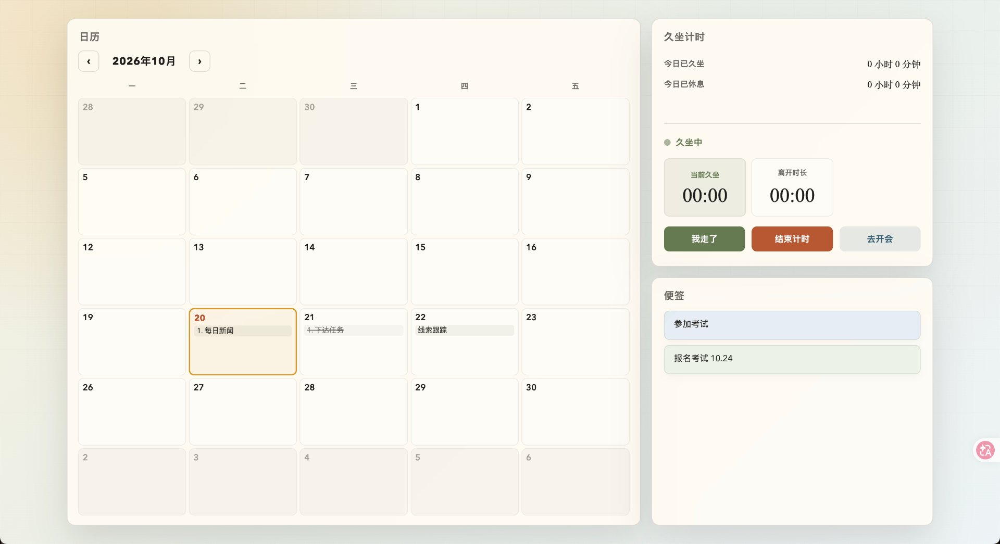
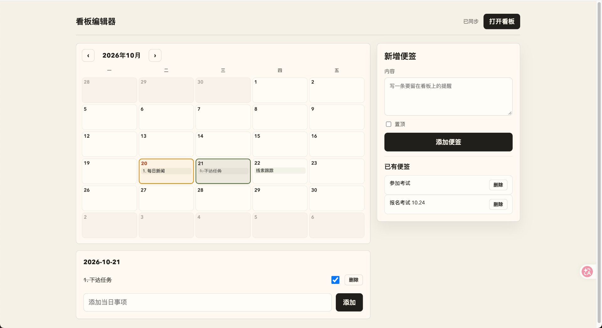

# 个人工作看板


一个**本地优先**的局域网看板系统：在 Mac（或任意一台常开电脑）上跑一个 FastAPI 服务，iPad / 手机 / 另一台电脑用浏览器打开就能看。日历、便签、久坐计时通过 WebSocket 实时同步——在电脑上改一下，iPad 秒级刷新。

- 🖥 **本地优先**：数据以 JSON 文件存在本机，无云依赖、无数据库，随改随看。
- ⚡ **实时推送**：文件监听 + WebSocket，编辑 `data/*.json` 或使用网页编辑器，看板立即更新。
- 📱 **为大屏而生**：横屏 iPad 常驻展示，组件可自由排序、调整大小。
- 🔧 **易于扩展**：新增一个组件只需四个文件级步骤（见下文）。

## 截图

| 看板（iPad 横屏展示） | 编辑器（Mac 上维护内容） |
| --- | --- |
| [](docs/images/dashboard.jpg) | [](docs/images/editor.jpg) |

左侧看板三分区：日历、久坐计时、便签。右侧编辑器是单页布局——左边周历选日期加事项，右边写便签，改完看板自动同步。

---

## 功能

| 组件             | 说明                              |
| -------------- | ------------------------------- |
| 日历 `calendar`  | 工作日周历视图，按天记录事项，可勾选完成            |
| 便签 `notes`     | 便签墙，置顶优先                        |
| 久坐计时 `sitting` | 连续久坐计时与提醒，含离座 / 回座 / 结束计时 / 去开会 |
| 休息提醒           | 按配置的时间点在看板上弹出休息提示               |

另含：单页网页编辑器（`/editor.html`）、健康检查。

## 技术栈

Python 3.10+ · FastAPI · Uvicorn · Pydantic v2 · WebSocket · watchdog · APScheduler · loguru。  
前端为零依赖的原生 HTML / CSS / JavaScript。

---

## 快速开始

```bash
# 1. 克隆
git clone https://github.com/wwJay1024/Personal-WorkDashboard-IPAD.git
cd Personal-WorkDashboard-IPAD

# 2. 一键安装：创建虚拟环境、安装依赖、按示例生成 config.yaml
./scripts/install.sh
source .venv/bin/activate

# 3. 启动（默认监听 0.0.0.0:9090）
./scripts/start_dashboard.sh
```

启动后访问：

| 用途          | 地址                                  |
| ----------- | ----------------------------------- |
| iPad / 大屏看板 | `http://<本机局域网 IP>:9090/`           |
| 网页编辑器       | `http://localhost:9090/editor.html` |
| 健康检查        | `http://localhost:9090/health`      |

查看本机局域网 IP（macOS）：

```bash
ipconfig getifaddr en0
```

> 端口可用环境变量覆盖：`DASHBOARD_PORT=8080 DASHBOARD_HOST=0.0.0.0 ./scripts/start_dashboard.sh`

---

## 配置

### `config.yaml` — 服务与提醒

由 `install.sh` 从 `config.yaml.example` 生成，包含：

- `server`：监听地址、端口、数据目录、看板配置文件路径。
- `reminder`：休息提醒，详见下节。

**不配置也能跑**：缺少 `config.yaml` 时程序使用内置默认值启动，可先跑起来再补。

### 休息提醒怎么设置

提醒完全由 `config.yaml` 的 `reminder` 段控制，没有其他入口：

```yaml
reminder:
  enabled: true                 # 总开关
  times:                        # 提醒时刻，24 小时制 HH:MM，想提醒几次就写几行
    - "10:00"
    - "11:00"
    - "15:00"
    - "16:30"
  weekdays_only: true           # 只在周一至周五触发
  message: 该休息一下了          # 弹层正文
  break_duration_seconds: 300   # 弹层倒计时秒数，归零自动关闭
```

| 字段 | 类型 | 默认值 | 说明 |
| --- | --- | --- | --- |
| `enabled` | bool | `true` | 总开关，`false` 则完全不再提醒 |
| `times` | 字符串数组 | `10:00`、`11:00`、`15:00`、`16:30` | 触发时刻，必须写成 `HH:MM`（如 `09:30`），按分钟精确匹配 |
| `weekdays_only` | bool | `true` | `true` 仅周一到周五；`false` 则每天 |
| `message` | string | `该休息一下了` | 弹层标题文案 |
| `break_duration_seconds` | int | `300` | 弹层倒计时长度（秒），到 0 自动关闭 |

运行行为：

- 服务端每 30 秒比对一次当前时间，命中 `times` 中的时刻就通过 WebSocket 广播，**所有已打开的看板页面同时弹出全屏提醒**，可点「继续工作」提前关掉。
- 每个时刻每天只触发一次，跨天自动重置。
- 属于即时推送：那一刻没开着的页面收不到，也不会补发或重放。
- 改完 `config.yaml` 要重启服务才生效。

### `dashboard.json` — 看板布局

控制看板上显示哪些组件、顺序、标题、大小与子配置。示例：

```json
{
  "version": "1.0",
  "title": "iPad 数据看板",
  "theme": "warm-ink",
  "components": [
    { "id": "calendar", "type": "calendar", "title": "日历", "size": "large-tall", "data_type": "calendar" },
    { "id": "sitting",  "type": "sitting",  "title": "久坐计时", "size": "medium", "data_type": "sitting", "options": { "caption": "连续久坐提醒" } },
    { "id": "notes",    "type": "notes",    "title": "便签", "size": "medium", "data_type": "notes", "options": { "caption": "置顶优先", "limit": 6 } }
  ]
}
```

`type` 需为上文「功能」表中已支持的组件类型。若 `dashboard.json` 不存在，服务会生成一份默认布局。

### `data/` — 运行时数据

`data/*.json` 是你的日程、便签、久坐记录等真实数据，首次运行自动生成，**已被 `.gitignore` 排除**。可直接编辑，保存后通过文件监听实时推送到看板。

---

## 使用方式

- **网页编辑**：打开 `http://localhost:9090/editor.html`，左边选日期加事项，右边写便签，改动即时同步到看板。
- **直接改文件**：编辑 `data/calendar.json`、`data/notes.json`，保存即推送。
- **改布局**：调整 `dashboard.json` 的组件顺序 / 大小 / 显隐。
- **改配置**：编辑 `config.yaml` 后重启服务生效。

### API 示例

```bash
# 读取某类数据
curl http://localhost:9090/api/data/calendar

# 新增一条日历事项
curl -X POST http://localhost:9090/api/data/calendar \
  -H "Content-Type: application/json" \
  -d '{"text":"周会","date":"2026-10-20"}'

# 健康检查
curl http://localhost:9090/health
```

数据类 CRUD 端点：`GET/POST /api/data/{type}`、`PUT/DELETE /api/data/{type}/{id}`；  
`{type}` 可为 `calendar`、`notes`。

久坐计时走独立端点（前缀 `/api/sitting`）：`GET /status`，`POST /start`、`/stop`、`/away`、`/back`、`/meeting/start`、`/meeting/stop`、`/reminder-response`。

---

## 扩展一个组件

1. 在 `app/models/` 增加对应的 Pydantic 模型（若有需要持久化的记录）。
2. 在 `app/main.py` 的 `data_service.register(...)` 注册数据类型。
3. 在 `static/app.js` 的 `renderers` 中新增同名渲染函数。
4. 在 `dashboard.json` 的 `components` 增加一条该组件的配置。

---

## 开机自启（macOS）

使用 `launchd` 常驻运行：

```bash
PROJECT_DIR="$(pwd)"
sed "s#__PROJECT_DIR__#$PROJECT_DIR#g" scripts/launchd.plist.template \
  > ~/Library/LaunchAgents/com.local.ipad-dashboard.plist
launchctl load ~/Library/LaunchAgents/com.local.ipad-dashboard.plist
```

停止 / 卸载：

```bash
launchctl unload ~/Library/LaunchAgents/com.local.ipad-dashboard.plist
```

---

## 目录结构

```
app/
  main.py            # FastAPI 应用装配与 WebSocket
  api/               # REST 路由（data / sitting / system）
  models/            # Pydantic 数据模型（CalendarItem / Note / SittingState / DashboardConfig）
  services/          # 数据服务、文件监听、久坐计时、休息提醒、调度
  config/            # 配置加载（config.yaml → settings）
static/              # 前端：index.html / editor.html / app.js / editor.js / styles.css
scripts/             # install.sh · start_dashboard.sh · launchd 模板
docs/images/         # README 截图
dashboard.json       # 看板布局
config.yaml.example  # 配置示例（复制为 config.yaml 使用）
data/                # 运行时数据（自动生成，不纳入版本库）
```

## 许可证

见仓库根目录 `LICENSE`（MIT）。
